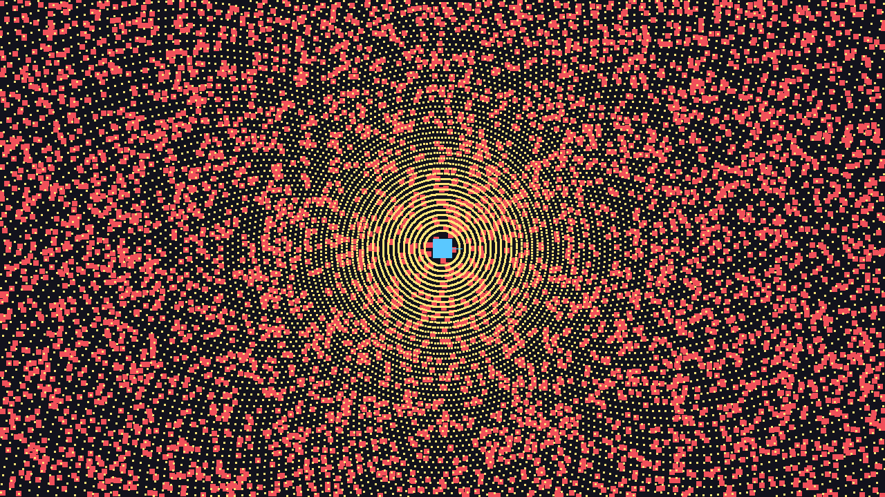
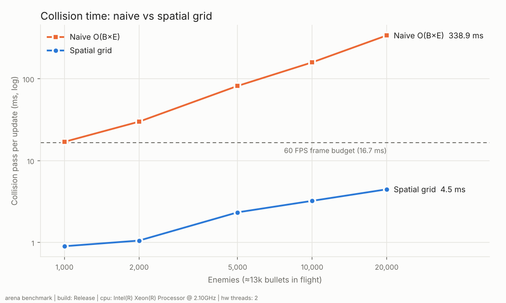

# Arena: a 2D shooter engine in C++20 / SDL2


A top-down arena shooter whose engine keeps **20,000 enemies and ~13,000 bullets** in a
**120 Hz fixed-timestep** simulation. It uses object pools, a counting-sort **spatial-grid
collision broadphase** (up to **76× faster** than brute force in the sample run below), and a
**struct-of-arrays** layout for hot entity data.

<!-- TODO: record a 10-15 s GIF (normal play -> F1 stress -> G to show naive slowing down)
     and replace the line below with:  -->


## Controls

| Key | Action |
|---|---|
| WASD | move |
| Mouse | aim; hold left button to fire |
| R | restart (also exits stress mode) |
| F1 | toggle stress mode |
| 1–5 | stress scene with 1,000 / 2,000 / 5,000 / 10,000 / 20,000 enemies |
| G | toggle collision: spatial grid ↔ naive O(B×E) |
| C | cycle grid cell size 16 → 32 → 64 px |
| B | toggle batched rendering |
| Esc | quit |

## Build and run (Ubuntu / WSL2)

```bash
sudo apt install build-essential cmake git libsdl2-dev libgtest-dev
cmake -S . -B build -DCMAKE_BUILD_TYPE=Release
cmake --build build -j
./build/arena                 # play (on Windows 11, WSLg shows the window on your desktop)
./build/arena --no-vsync      # uncapped frame rate, for FPS measurements
ctest --test-dir build --output-on-failure
```

`libgtest-dev` is optional: if CMake can't find GoogleTest it downloads v1.15.2.

## Architecture

```
 every frame:  poll input ─► accumulator += frame time (capped at 0.25 s)
                              │
                              ▼
               while accumulator ≥ 1/120 s:   update(1/120)   ◄── all perf work lives here
                 move bullets ─► move enemies ─► build grid ─► collide ─► remove dead
                              │
                              ▼
               render once (batched rects), present
```

**Fixed timestep.** The simulation always advances in 1/120 s steps, however fast the screen
draws. Physics doesn't change with frame rate, runs are reproducible (fixed RNG seed), and the
engine can be tested and benchmarked headless. Frame time is clamped to 0.25 s so a slow frame
can't trigger the "spiral of death", where catching up takes longer than the time being caught up.

**Object pools** (`src/Pool.hpp`). Every slot is allocated once at startup, so firing never
allocates. Removal is O(1) swap-and-pop: the last live item moves into the dead slot and live
items stay packed. Loops that kill iterate backwards. Collisions *mark* entities dead and a
separate pass removes them, because removing inside the pair loop would swap an untested
entity into the current index.

**Spatial grid broadphase** (`src/SpatialGrid.hpp`). The arena is split into 32 px cells. Each
update, enemies are bucketed with a **counting sort into two flat arrays**: `cellStart_` (a
prefix sum of per-cell counts) and `items_` (enemy indices grouped by cell). That's two linear
passes, no allocation after the first update, and memory read in order. Each bullet then checks
only enemies in the cells its circle overlaps. A randomized GoogleTest property test checks that
the grid finds *exactly* the same hits as brute force at 5 cell sizes, and the benchmark repeats
that check on the real game scene.

**Struct of arrays** (`src/Enemies.hpp`). Enemies are stored as parallel arrays (`x[]`, `y[]`,
`speed[]`, …) instead of an array of structs. The chase loop streams only the three fields it
uses, and GCC auto-vectorizes it at `-O3` (CMake's Release default). It does **not** vectorize at
`-O2`, which you can check with `-fopt-info-vec-optimized`.

**Stress mode** keeps the work per update fixed: enemies drift and bounce instead of chasing,
the player is parked in the center firing a rotating ring of 200 bullets per update, bullets
pierce, and nothing dies. Every run of a given enemy count does identical work, so naive and
grid can be compared fairly.

## Performance

How to reproduce:

```bash
./build/arena --bench | tee bench/results.csv     # headless, ~2 min, no window needed
python3 bench/plot.py bench/results.csv           # prints the tables, writes bench/collision.png
./build/bench_layout                              # AoS vs SoA micro-benchmark
```

Rules: Release build, laptop plugged in, other apps closed, fixed RNG seed (built in). The
benchmark prints the CPU model on its first line. For FPS, run `./build/arena --no-vsync`,
press F1 then 1–5, and read the title bar.

> **The numbers below are a sample run on a 2-thread cloud VM** (Intel Xeon @ 2.10 GHz),
> included so you can see the expected shape. Replace them with your own machine's results.



| Enemies | Bullets | Naive collide (ms) | Grid collide (ms) | Speedup | FPS (grid, no vsync) |
|---:|---:|---:|---:|---:|---:|
| 1,000 | 13,433 | 17.00 | 0.90 | 19× | _yours_ |
| 2,000 | 13,433 | 29.96 | 1.05 | 28× | _yours_ |
| 5,000 | 13,433 | 81.87 | 2.34 | 35× | _yours_ |
| 10,000 | 13,433 | 158.93 | 3.23 | 49× | _yours_ |
| 20,000 | 13,433 | 338.93 | 4.47 | 76× | _yours_ |

The naive pass is past the 16.7 ms frame budget already at 1,000 enemies with this many bullets,
and grows linearly with enemies (bullets are fixed). The grid stays far below budget at 20,000.

**Cell size** at 10,000 enemies: 16 px = 2.74 ms, 32 px = 3.23 ms, 64 px = 4.03 ms. Smaller cells
won here because a query's 15 px radius covers only a few 16 px cells, each holding few enemies.
Larger cells mean scanning many enemies that can't possibly overlap.

**AoS vs SoA** (enemy chase update, same math, only layout differs; `bench_layout`):

| Enemies | AoS (ms/update) | SoA (ms/update) | Speedup |
|---:|---:|---:|---:|
| 10,000 | 0.0150 | 0.0064 | 2.3× |
| 20,000 | 0.0276 | 0.0126 | 2.2× |
| 1,000,000 | 2.32 | 0.94 | 2.5× |

Honest caveat: the SoA win is real (it comes from vectorization), but at game scale the enemy
update was never the bottleneck: 0.015 ms vs a collision pass in milliseconds. The layout matters
more for whatever becomes the hot loop next.

**Debug vs Release** (quick benchmark, same scene): grid 2.82 ms vs 0.58 ms (~5×), naive at
2,000 enemies 345 ms vs 35 ms (~10×). Always benchmark Release builds. Cloud-VM timings also
vary by ±30% between runs, so run the benchmark twice and report the steadier run.

**Rendering.** Once collisions were cheap, issuing one draw call per rectangle became a
significant cost. Batching rects by color into one `SDL_RenderFillRectsF` call (toggle with
**B**) cut CPU render time at 20,000 enemies + 13,000 bullets from 0.85 ms to 0.22 ms with
SDL's software renderer on the VM.
<!-- TODO: replace with what `perf report` showed on YOUR machine (see "Profiling"). -->

## Testing and tooling

- **GoogleTest** (`tests/test_grid.cpp`): grid vs brute-force property tests, Pool swap-and-pop,
  SoA kill, `circlesOverlap` edge cases (touching ≠ overlapping).
- **Headless engine test**: `ctest` also runs `arena --bench --quick`, which fails if grid and
  naive ever disagree.
- **Sanitizers**:
  ```bash
  cmake -S . -B build-asan -DCMAKE_BUILD_TYPE=Debug \
    -DCMAKE_CXX_FLAGS="-fsanitize=address,undefined -fno-omit-frame-pointer"
  cmake --build build-asan -j && ctest --test-dir build-asan && ./build-asan/arena
  ```
- **CI** (`.github/workflows/ci.yml`): a Release build + tests and an ASan/UBSan build + tests on
  every push.

### Profiling (WSL2)

```bash
sudo apt install linux-tools-generic
# WSL2's kernel doesn't match Ubuntu's linux-tools package, so call the perf binary directly:
PERF=$(ls /usr/lib/linux-tools/*/perf | head -1)
$PERF record -g ./build/arena --bench --quick     # or play stress mode for ~20 s
$PERF report
```

## Learning from the git history

Each step of the build is one commit, tagged `step-0` … `step-11`:

```bash
git log --oneline              # the whole progression
git checkout step-5            # the playable game with naive collisions
git diff step-5 step-6         # exactly what the spatial grid changed
git checkout main
```

See [`docs/BUILD_NOTES.md`](docs/BUILD_NOTES.md) for where this build differs from the original
guide and why, and [`docs/INTERVIEW_NOTES.md`](docs/INTERVIEW_NOTES.md) for interview prep.

## What I learned / what's next

<!-- TODO: write this in your own words after you've rebuilt and measured it. -->

Next steps: compile to WebAssembly with Emscripten and host on GitHub Pages; split the bullet
loop across threads with `std::jthread` and measure scaling; compare against a quadtree on
clumped vs spread-out enemies; sprites and sound with SDL_image / SDL_mixer; port to SDL3.

## License

MIT, see [LICENSE](LICENSE).
